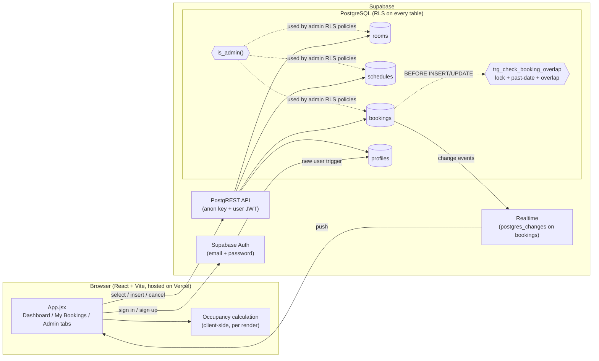

# CampusFlow | University Classroom Booking Dashboard

**Live demo:** https://smart-classroom-booking-system.vercel.app

CampusFlow is a full-stack, real-time university classroom booking dashboard for students and faculty. It shows live classroom occupancy (Green = vacant, Red = occupied by a scheduled class, Yellow = booked ad-hoc) based on recurring weekly timetables and active reservations, and lets signed-in users book free slots.

---

## Features

- **Live occupancy grid**: every room on a 08:00–22:00 timeline for any date, with a time slider ("time travel") and a live "now" line.
- **Booking with double-booking protection**: instant client-side check, then a PostgreSQL trigger that is the real guard (also safe under concurrent requests).
- **Real-time updates**: bookings made or cancelled in one tab or by another user appear everywhere instantly (Supabase Realtime).
- **My Bookings page**: your upcoming and past bookings with room, date, time and status; cancel upcoming ones.
- **Soft cancel**: cancelling sets `status = 'cancelled'`; rows are never deleted, so history is kept.
- **Admin role** (`student` | `admin`), enforced by Row Level Security:
  - add / edit / delete rooms (deletion is blocked while a room has upcoming bookings),
  - see all bookings and cancel any upcoming one,
  - **usage analytics**: bookings per room and peak booking hours for the last 30 days (plain SVG charts, with a table view).
- **Campus timezone**: "today" is always computed in **Asia/Kolkata (IST)**, both in the UI and in the database.
- Light / dark theme.

## Tech Stack

- **Frontend**: React 19 (Vite) + Tailwind CSS v4
- **Backend / DB**: Supabase (PostgreSQL, Auth, Realtime, Row Level Security)
- **Hosting**: Vercel (static build)
- **Libraries**: `@supabase/supabase-js`, `lucide-react` (icons), `canvas-confetti`

---

## Architecture



### Main files

| File | Purpose |
|---|---|
| `src/App.jsx` | Loads rooms/schedules/bookings, Realtime subscription, occupancy grid, tab navigation |
| `src/components/BookingModal.jsx` | Booking form, client-side pre-checks, insert |
| `src/components/RoomCard.jsx` | Room info + live status badge |
| `src/components/MyBookings.jsx` | Upcoming / past bookings of the signed-in user |
| `src/components/AdminPanel.jsx` | Admin: manage rooms, all bookings |
| `src/components/AdminAnalytics.jsx` | Admin: SVG charts for the last 30 days |
| `src/lib/time.js` | Asia/Kolkata date/time helpers |
| `src/lib/bookings.js` | `cancelBooking()` (soft cancel) and `isUpcoming()` |
| `schema.sql` | Full schema for a **fresh** project (already includes all migrations) |
| `migration_0X_*.sql` | Incremental changes for an **existing** project |

### How occupancy is calculated

Occupancy is computed in the browser on every render, so it is never stale:

1. Work out the day of week of the selected date (`getDayOfWeek`, timezone-safe).
2. If a **schedule** (recurring class) for that room and weekday covers the selected time → **Occupied** (red).
3. Else, if a **confirmed booking** for that room and date covers the selected time → **Booked** (yellow).
4. Otherwise → **Vacant** (green).

Cancelled bookings are never fetched for the grid and never counted.

### How real-time updates work

- The dashboard subscribes to `postgres_changes` on `public.bookings`. On any insert/update it re-fetches the confirmed bookings for the selected date, so every open tab recalculates occupancy immediately.
- **My Bookings** has its own channel filtered to `booked_by = <current user>`.
- **Admin** has its own channel so the bookings list and charts refresh live.
- Realtime respects RLS: a client only receives events for rows it is allowed to `SELECT`.

---

## Double-Booking Protection

CampusFlow uses two layers.

### 1. Database trigger (the real guard)

`trg_check_booking_overlap` runs `BEFORE INSERT OR UPDATE` on `bookings` and calls `check_booking_overlap()`, which:

1. **Takes a lock** – `pg_advisory_xact_lock(hashtext(room_id || date))`. Two transactions booking the same room on the same day are serialised, so the second one always sees the first one's row. Without this lock, two simultaneous requests could both pass the overlap check (race condition).
2. **Rejects past dates on INSERT only** – compares against `(now() AT TIME ZONE 'Asia/Kolkata')::date`. It is INSERT-only so cancelling an old booking (an UPDATE) always works.
3. **Ignores non-confirmed rows** – cancelled bookings never block anything.
4. **Checks schedules** – any recurring class in the same room on the same weekday where `start_time < NEW.end_time AND end_time > NEW.start_time`.
5. **Checks bookings** – any other *confirmed* booking in the same room on the same date with an overlapping time.

If any check fails the statement is aborted with `RAISE EXCEPTION`, and the message is shown in the booking modal. The function is `SECURITY DEFINER` with `search_path = public`, so it always sees every booking regardless of the caller's RLS visibility.

### 2. Client-side pre-check

`BookingModal` checks the proposed slot against the schedules and bookings already loaded (and kept in sync by Realtime) and rejects past dates, giving instant feedback before any request is sent.

### Cancellation

Bookings are **soft-cancelled**: the app sets `status = 'cancelled'` and keeps the row. Cancelled rows are ignored by the trigger and by the occupancy calculation, so the slot is free again immediately.

---

## Security Model (Row Level Security)

RLS is enabled on every table. The UI hides admin features from students, but **the database enforces every rule**.

| Table | Anyone (anon) | Signed-in student | Admin |
|---|---|---|---|
| `rooms` | read | read | read, insert, update, delete* |
| `schedules` | read | read | read, insert, update, delete |
| `bookings` | read | insert own (as `confirmed`); cancel own confirmed booking | + cancel any confirmed booking |
| `profiles` | – | read own row | read all rows |

- Only the `status` column of `bookings` is updatable from the API (`GRANT UPDATE (status)`), and the only allowed change is `confirmed → cancelled`. Room, date, time and owner can never be edited, and a cancelled booking cannot be re-activated.
- `DELETE` / `TRUNCATE` on `bookings` are revoked: nothing is hard-deleted from the API.
- `profiles` has **no** insert/update policy, so nobody can promote themselves. Profiles are created by a `SECURITY DEFINER` trigger on `auth.users`; roles are changed manually in the SQL Editor.
- Admin policies call `is_admin()`, a `SECURITY DEFINER` function, so policies never query `profiles` recursively.
- \* A room with upcoming confirmed bookings cannot be deleted (`trg_block_room_delete`). Because `bookings.room_id` is `ON DELETE CASCADE`, deleting a room removes its past/cancelled bookings and timetable; the admin UI warns about this before deleting.
- Only the public **anon** key is used in the frontend. The service-role key is never used.

---

## Setup

### 1. Supabase – new project

1. Create a project at [supabase.com](https://supabase.com/).
2. Open **SQL Editor** and run, in this order:
   1. [`schema.sql`](schema.sql) – tables, RLS policies, triggers, profiles/admin (already includes migrations 01–03).
   2. [`seed.sql`](seed.sql) – sample rooms across several buildings and their weekly timetables.
   3. [`indexes.sql`](indexes.sql) – indexes for the overlap check.
3. Enable Realtime for `bookings`: **Database → Publications → `supabase_realtime`** and toggle `bookings` on (older dashboards: **Database → Replication**). Or run:
   ```sql
   ALTER PUBLICATION supabase_realtime ADD TABLE public.bookings;
   ```
4. **Authentication → URL Configuration**: set *Site URL* to your Vercel URL and add `http://localhost:5173` to *Redirect URLs* (used by the sign-up confirmation email).

### 2. Supabase – existing project (upgrading)

If your project was created from the **old** `schema.sql`, do **not** re-run `schema.sql`. Instead run the migrations, one at a time, in order, in the SQL Editor:

| Order | File | What it does |
|---|---|---|
| 1 | [`migration_01_date_check_timezone.sql`](migration_01_date_check_timezone.sql) | Drops `CHECK (date >= CURRENT_DATE)`; trigger gets advisory lock, IST past-date check on INSERT, `SECURITY DEFINER` |
| 2 | [`migration_02_rls_hardening.sql`](migration_02_rls_hardening.sql) | Users can only cancel their own confirmed bookings; `UPDATE` limited to `status`; no hard deletes |
| 3 | [`migration_03_profiles_admin.sql`](migration_03_profiles_admin.sql) | `profiles` table, `is_admin()`, sign-up trigger + backfill, admin policies, room-delete guard |

Each migration is wrapped in a transaction, is safe to re-run, and has a rollback section in its header comment.

### 3. Make yourself an admin

Sign up in the app first, then run in the SQL Editor (replace the email):

```sql
UPDATE public.profiles SET role = 'admin' WHERE email = 'your-email@example.com';

-- check
SELECT id, email, role FROM public.profiles WHERE role = 'admin';
```

Sign out and back in (or refresh); the **Admin** tab appears.

### 4. Local development

```bash
git clone <repo-url>
cd Smart-Classroom-Booking-System
npm install
cp .env.example .env      # then fill in the two values below
npm run dev               # http://localhost:5173
```

`.env` (never commit this file; it is in `.gitignore`):

```env
VITE_SUPABASE_URL=https://your-project.supabase.co
VITE_SUPABASE_ANON_KEY=your-anon-key
```

Both values are in Supabase under **Project Settings → API**. Use the **anon / public** key only.

Other scripts: `npm run build` (production build to `dist/`), `npm run lint` (oxlint), `npm run preview`.

### 5. Deploy to Vercel

1. In Vercel, **Add New → Project** and import the Git repository.
2. Framework preset: **Vite**. Build command `npm run build`, output directory `dist` (the defaults).
3. **Settings → Environment Variables**: add `VITE_SUPABASE_URL` and `VITE_SUPABASE_ANON_KEY` (Production and Preview).
4. Deploy. After changing environment variables, **redeploy** – Vite inlines them at build time.
5. Make sure the Vercel URL is set as the Site URL in Supabase Auth (step 1.4).

---

## Testing

### Automated API tests (`tests/`)

[`tests/api-tests.mjs`](tests/api-tests.mjs) checks the database rules through the public API, using the anon key and real user sessions just like the app. It covers sign-up/profile creation, concurrent double-booking, schedule and past-date rejection, cancel rules, column-level edit protection, student/anonymous/admin permissions and the room-delete guard. Results are printed and written to [`tests/TEST_RESULTS.md`](tests/TEST_RESULTS.md), with the project ref and test emails redacted.

**Always run it against a separate test Supabase project, never production.** It creates throw-away users and bookings.

1. Create a second Supabase project. In its SQL Editor run `schema.sql`, `seed.sql` and `indexes.sql`.
2. In that project go to **Authentication → Sign In / Providers → Email** and turn off **Confirm email**.
3. Create `.env.test` in the repo root (it is git-ignored) with that project's values:
   ```env
   VITE_SUPABASE_URL=https://your-test-project-ref.supabase.co
   VITE_SUPABASE_ANON_KEY=your-test-anon-key
   ```
   The script reads only `.env.test` and refuses to run with a secret/service-role key.
4. Run:
   ```bash
   npm run test:api
   ```
5. After the student and anonymous tests, it prints an `UPDATE public.profiles SET role='admin' ...` statement. Run it in the test project's SQL Editor, then press Enter (in a terminal) and the admin tests run.
6. Optional clean-up: the test users stay in **Authentication → Users**. Delete them there, or with `DELETE FROM auth.users WHERE email LIKE '%+<run id>@example.com';` (this also removes their profiles and bookings).

### Manual test cases

Use two different accounts (**User A**, **User B**) and, for admin tests, an account promoted to admin. Some tests use the SQL Editor to act as a specific user:

```sql
-- Run as a given user inside a transaction that is rolled back afterwards.
BEGIN;
SET LOCAL ROLE authenticated;
SET LOCAL request.jwt.claims = '{"sub": "<USER-UUID>", "role": "authenticated"}';
-- ... statement under test ...
ROLLBACK;
```

(User UUIDs are in **Authentication → Users** or `SELECT id, email FROM profiles;`.)

| # | Test | Steps | Expected result |
|---|---|---|---|
| 1 | **Double booking** | User A books Room 101 tomorrow 14:00–15:00. User B tries to book Room 101 tomorrow 14:30–15:30. | B's modal shows *"Overlaps with an existing booking"*. Even if the client check is bypassed, the DB raises *"Booking overlaps with an existing confirmed booking."* Only one booking exists. |
| 2 | **Booking over a scheduled class** | Pick a Monday; try to book Room 101 09:30–10:00 (Introduction to Physics 09:00–10:30). | Rejected: *"Overlaps with recurring class ..."* |
| 3 | **Race condition (two tabs)** | Open the app in two tabs (A and B). In both, open the booking modal for the same room, date and time. Click **Confirm** in both as close together as possible. | Exactly one succeeds; the other shows *"Booking overlaps with an existing confirmed booking."* For a deterministic version, in SQL Editor tab 1 run `BEGIN; INSERT INTO bookings (...) VALUES (...); SELECT pg_sleep(10); COMMIT;` and within 10 s run the same insert in tab 2: tab 2 **waits** for the lock, then fails with the overlap error. |
| 4 | **Past-date booking** | In the modal choose yesterday (bypass the date picker by typing), or insert via SQL with `date = CURRENT_DATE - 1`. | Rejected: *"You cannot book a date in the past"* (UI) / *"Cannot book a date in the past (today in Asia/Kolkata is …)"* (DB). |
| 5 | **Cancel own booking** | As User A, open **My Bookings** and cancel an upcoming booking. | Status becomes `cancelled` (row still exists); it moves out of the grid in all tabs, and the slot can be booked again. |
| 6 | **Cancel a past booking** (regression for the old CHECK bug) | In SQL Editor (as `postgres`) set a confirmed booking's date to last week, then run `UPDATE bookings SET status = 'cancelled' WHERE id = '<id>';`. | Succeeds (previously failed with `bookings_date_check`). |
| 7 | **Cancel someone else's booking** | Using the SQL snippet above as User B: `UPDATE bookings SET status = 'cancelled' WHERE id = '<User A booking>' RETURNING id;` | `UPDATE 0`, no rows returned; the booking stays `confirmed`. In the UI, B never sees a cancel button for A's booking. |
| 8 | **Edit / re-activate a booking** | As User A (SQL snippet): `UPDATE bookings SET date = date + 1 WHERE id = '<own id>';` then `UPDATE bookings SET status = 'confirmed' WHERE id = '<own cancelled id>' RETURNING id;` | First: *"permission denied for table bookings"* (only `status` is updatable). Second: `UPDATE 0`. |
| 9 | **Non-admin trying admin actions** | As a student (SQL snippet): `INSERT INTO rooms (name, building, capacity) VALUES ('Hack', 'X', 10);`, `DELETE FROM rooms RETURNING id;`, `UPDATE profiles SET role = 'admin' WHERE id = '<own id>';` | Insert: *"new row violates row-level security policy"*. Delete: `DELETE 0`. Profile update: *"permission denied for table profiles"*. The **Admin** tab is not shown in the UI. |
| 10 | **Admin actions** | As an admin: add a room, rename it, view All Bookings, cancel another user's upcoming booking, try to delete a room that has an upcoming booking. | Room add/edit works and appears on the dashboard; the cancellation works; deleting the room is blocked with *"has N upcoming confirmed booking(s)"*. |
| 11 | **Realtime across tabs** | Open the dashboard in two browsers (one signed in as A, one as guest) on the same date. A books a slot, then cancels it. | The yellow/green block appears in the other browser within ~1 s without refreshing, then disappears after cancel. Vacant/Booked counters update too. |
| 12 | **Timezone edge near midnight** | Between 00:00 and 05:29 IST (18:30–23:59 UTC) the IST date is one day ahead of UTC. Check `SELECT (now() AT TIME ZONE 'Asia/Kolkata')::date AS ist, (now() AT TIME ZONE 'UTC')::date AS utc;`. Then try to book for the IST date and for the UTC date. | IST date: allowed (it is "today"). UTC date (= yesterday in IST): rejected as a past date. The dashboard opens on the IST date and the live line is at the IST time, whatever the browser's timezone. |
| 13 | **Analytics** | As admin, open **Admin → Usage Analytics** after creating a few bookings. | Bars per room match the confirmed bookings of the last 30 days; cancelled bookings are not counted; "Show as table" shows the same numbers. |

---

## Future Scope

- **Hide who booked what from the public.** `bookings` is publicly readable so guests see live occupancy and Realtime works for them; the trade-off is that `booked_by` user UUIDs (not emails) are visible to anyone. A future version could restrict `SELECT` to authenticated users, or expose an anonymised view and broadcast changes via Realtime Broadcast instead of `postgres_changes`.
- **Recurring bookings** ("repeat weekly for N weeks"), each occurrence checked by the trigger.
- **Timetable editor** for admins (the RLS policies for `schedules` already exist).
- **Exclusion constraint** (`btree_gist` + `EXCLUDE USING gist`) as an additional declarative guard against overlaps.
- An index on `bookings (booked_by, date)` for very large datasets.

---

## License

[MIT](LICENSE) © 2026 Pavalasri K
